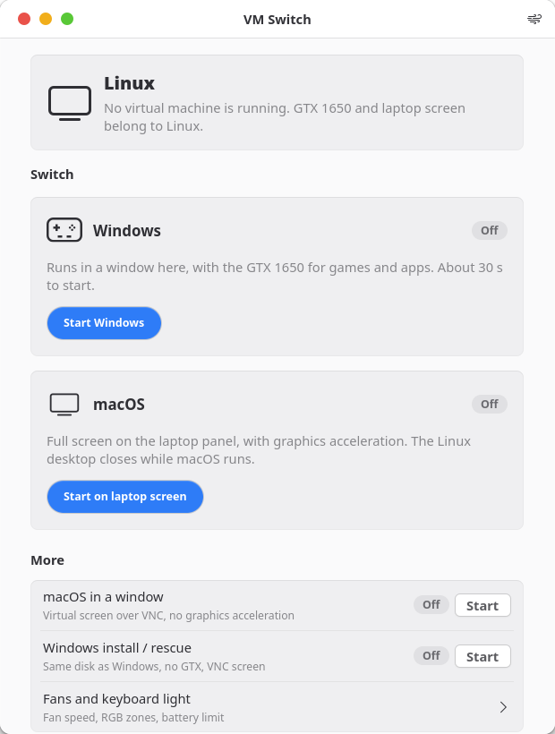
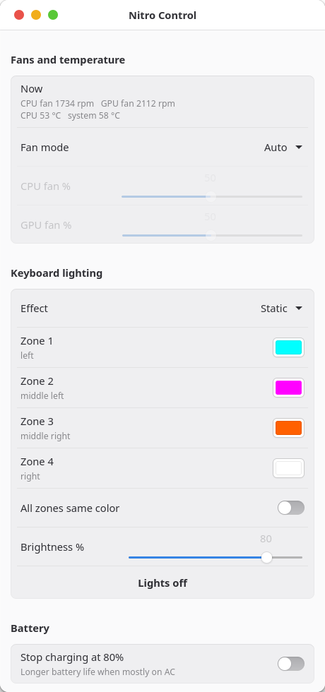

# Laptop host: Acer Nitro AN515-55 on CachyOS

Linux, macOS and Windows on one hybrid-GPU laptop, without rebooting:
- **Linux** (CachyOS + GNOME) is the host and owns the laptop by default.
- **macOS** (the laptop's own Hackintosh disk) runs as a VM with the **Intel iGPU** passed through, full screen
  on the laptop panel, Metal 3 (`gpu-mode mac`).
- **Windows 10** runs as a VM with the **GTX 1650** passed through, shown in a Looking Glass window on the
  Linux desktop (`win-gpu`).
- **Fans, keyboard RGB, battery limit** like Acer NitroSense: app **Nitro Control** or `nitro` (Linux only).

This folder is separate from the desktop server setup in the repo root (`host/`, `vm/`, `docs/`): nothing here
is shared with it.

## Apps (no terminal needed)
| App (app grid) | What | Install |
|---|---|---|
| **VM Switch** | See what runs; buttons to start/stop Windows on the GTX, macOS on the laptop screen, the VNC VMs; Windows desktop, or Windows apps as Linux windows (Coherence-style, app grid folder "Windows") | `sudo bash laptop/host/vm-switch/install.sh` |
| **Nitro Control** | Fans (auto / max / custom), 4-zone keyboard RGB and effects, 80% battery limit, live RPM and temps | `sudo bash laptop/host/nitrosense/install.sh` |
| **Windows (GTX 1650)** | Starts Windows and opens its window in one click | part of `01-host-setup.sh` |

The first GPU switch asks for your password; it is remembered for a few minutes.

| VM Switch | Nitro Control |
|---|---|
|  |  |

## Quick use (terminal)

| From | To | Do this | Time |
|---|---|---|---|
| Linux | Windows | App grid > **Windows (GTX 1650)**, or `win-gpu` | about 30 s |
| Windows | Linux | Windows Start > Shut down, or `win-gpu stop` | about 10 s |
| Windows window | (keyboard/mouse) | **Right Ctrl** grabs / releases; Right Ctrl + F full screen | |
| Linux | macOS | `sudo gpu-mode mac` (Linux desktop closes) | 60-100 s |
| macOS | Linux | Apple menu > Shut Down (or `ssh <user>@<laptop> sudo gpu-mode host`) | about 1 min |
| macOS | Windows | go back to Linux first, then `win-gpu` | |
| anything stuck | Linux | hold the power button; every boot starts in Linux | |

Fans / RGB: app grid > **Nitro Control**, or `nitro fan max`, `nitro rgb red`, `nitro effect breath red`.

Status of everything: `sudo gpu-mode status`. Log: `journalctl -t gpu-mode`.

## Docs
| Doc | What |
|---|---|
| [docs/01-hardware-and-software.md](docs/01-hardware-and-software.md) | Every device, IDs, versions, which OS owns what in each mode |
| [docs/02-setup-from-scratch.md](docs/02-setup-from-scratch.md) | Full setup in order: BIOS, CachyOS, host script, macOS, Windows |
| [docs/03-macos.md](docs/03-macos.md) | macOS on the panel and in a window: use, how it works, one-time build |
| [docs/04-windows.md](docs/04-windows.md) | Windows on the GTX: use, how it works, guest setup |
| [docs/05-lessons-learned.md](docs/05-lessons-learned.md) | What broke and why (read before changing anything) |
| [docs/06-open-items.md](docs/06-open-items.md) | Not done yet, ideas |
| [docs/07-fan-and-rgb.md](docs/07-fan-and-rgb.md) | NitroSense on Linux: fans, 4-zone keyboard RGB, battery limit |
| [docs/09-windows-apps.md](docs/09-windows-apps.md) | Windows apps as their own Linux windows (WinApps, like Coherence) |
| [docs/08-share-keyboard-mouse.md](docs/08-share-keyboard-mouse.md) | Use a Mac's keyboard and mouse on the laptop (Deskflow) |

## Files
| Path | What |
|---|---|
| `host/00-inspect.sh`, `01-host-setup.sh`, `02-verify.sh` | read-only report, setup, health check |
| `host/gpu-mode` | the switch: `mac`, `host`, `win`, `win-off`, `status` |
| `host/vm-switch/` | VM Switch app (GTK4), polkit rule for `gpu-mode`, installer |
| `host/win-gpu`, `host/looking-glass/` | Windows launcher, menu entry, Looking Glass client build + config |
| `host/touchpad-bridge` | touchpad as a tap-to-click mouse for macOS |
| `host/nitrosense/` | fan/RGB driver install (linuwu_sense, DKMS), `nitro` command, Nitro Control app |
| `host/session/`, `host/gtx-run` | desktop draws on Intel only (GTX always free for Windows); `gtx-run <app>` for the GTX in Linux |
| `host/winapps/` | WinApps setup (Windows apps as Linux windows) |
| `host/wexec` | run PowerShell in a Windows VM from Linux (QEMU guest agent) |
| `host/libvirt-hooks/qemu` | auto return to Linux when a passthrough VM stops |
| `host/udev/`, `host/systemd/`, `host/tmpfiles/` | disk name, touchpad, GNOME keeps off the GTX, Looking Glass shared memory |
| `vm/macos/` | macOS domains, OpenCore config generator, Intel GOP image build |
| `vm/windows/` | Windows domains, fake battery SSDT |
| `host/attic-kimi/` | old scripts that blacked out the laptop. Reference only, never run |

## Rules
- Never bind the GTX to vfio-pci at boot, never blacklist nvidia, never hand-edit `limine.conf`.
- Never write to the Hackintosh disk directly: VMs use the overlay on `/dev/hackintosh-disk`.
- Start passthrough VMs only through `gpu-mode` / `win-gpu`, never `virsh start` directly.
- No VM autostart. Never commit serials, VBIOS/GOP binaries, images or passwords.
- Before risky changes: `sudo snapper -c root create -d "before <change>"` (bootable from the Limine menu).
