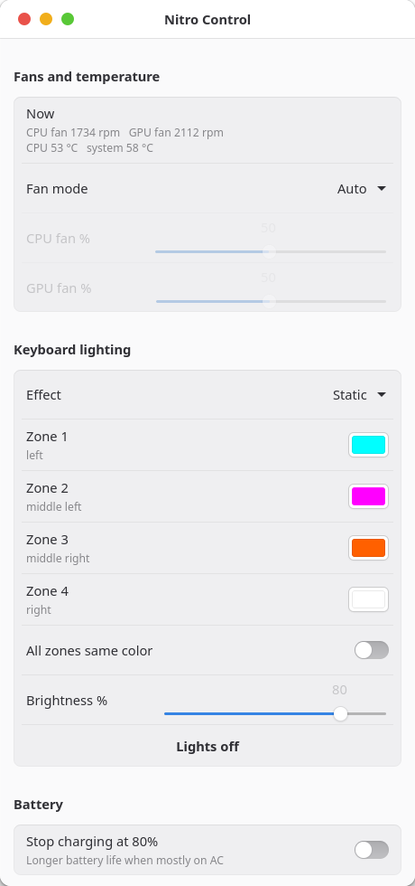

# Fans, keyboard RGB, battery limit (NitroSense on Linux)

Acer's NitroSense app is Windows only. On Linux the same controls come from the `linuwu_sense` kernel module
(a fork of the stock `acer_wmi` driver), plus a small app and command from this repo.

## Use


- App grid > **Nitro Control**: live fan RPM and temperatures, fan mode (Auto / Max / Custom % per fan),
  keyboard effect and colors per zone, brightness, speed, direction, lights off, "Stop charging at 80%".
  Changes apply right away.
- Terminal:
  ```
  nitro                           # status
  nitro fan auto | max            # EC fan curve, or both fans 100%
  nitro fan 60 70                 # CPU 60%, GPU 70% fixed
  nitro rgb red                   # all 4 zones red
  nitro rgb cyan magenta orange white 80   # zone 1 (left) .. zone 4 (right), brightness 80%
  nitro rgb off
  nitro effect breath red         # breath | neon | wave | shift | zoom | meteor | twinkle  [color speed brightness dir]
  nitro battery-limit on|off      # stop charging at 80%
  ```
- The last fan and keyboard setting comes back at every login (`nitro restore`, autostart). Settings are in
  `~/.config/nitro/state`.
- The Fn keys on the laptop keep working (the module also does what `acer_wmi` did: hotkeys, Wi-Fi/Bluetooth rfkill).

Measured 2026-11-20: Auto about 1500 / 1900 rpm idle, 50% about 3400 / 3900 rpm, Max about 5700 / 6100 rpm (CPU / GPU fan).

## Install
```
sudo bash laptop/host/nitrosense/install.sh
```
Then log out and in once. The script:
1. Checks the model is an AN515-55 (other models use other WMI payloads).
2. Takes a snapper snapshot ("before linuwu_sense").
3. Clones [BillyAddlers/Linuwu-Sense-AN515-55-Patch](https://github.com/BillyAddlers/Linuwu-Sense-AN515-55-Patch)
   to `~/src/Linuwu-AN515-55` at the tested commit, and runs its `scripts/install-dkms.sh`:
   DKMS module (rebuilt on every kernel update), `acer_wmi` blacklisted, `/etc/modules-load.d/linuwu_sense.conf`,
   `linuwu_sense.service`, group `linuwu_sense` with the user in it, `/etc/tmpfiles.d/linuwu_sense.conf`.
4. Installs from `host/nitrosense/`: `nitro`, `nitro-control` + menu entry, the login restore
   (`/etc/xdg/autostart/nitro-restore.desktop`) and a drop-in for `linuwu_sense.service` that sets the sysfs
   permissions after the module loads.

Driver files: `/sys/module/linuwu_sense/drivers/platform:acer-wmi/acer-wmi/` with `nitro_sense/` (fan_speed,
battery_limiter, battery_calibration, usb_charging, backlight_timeout), `four_zoned_kb/` (per_zone_mode,
four_zone_mode) and `hwmon/hwmon*/` (fan1/fan2 RPM, temps).

## Undo
```
sudo bash ~/src/Linuwu-AN515-55/scripts/uninstall-dkms.sh     # back to the stock acer_wmi
sudo rm /usr/local/bin/nitro /usr/local/bin/nitro-control /usr/local/share/applications/nitro-control.desktop \
  /etc/xdg/autostart/nitro-restore.desktop
sudo rm -r /etc/systemd/system/linuwu_sense.service.d
```
Or boot the snapshot "before linuwu_sense" from the Limine menu.

## Notes
- No thermal profiles (quiet / balanced / performance) on this model: `platform_profile probe failed` in dmesg is
  expected. Fans are set directly.
- The driver saves the keyboard state in `/etc/four_zone_kb_state` at shutdown, but already scaled by the
  brightness, so colors got dimmer after each reboot. The login restore re-sends the original values.
- The upstream tmpfiles rule runs before the module loads at boot, so the files stayed root-only:
  `10-permissions.conf` re-applies it from `linuwu_sense.service`.
- Do not `systemctl restart linuwu_sense.service`: its ExecStop unloads the module.
- With an older `acer_wmi`, `modprobe acer_wmi predator_v4=1` gives fan modes until the next reboot (no RGB).

## macOS (native Hackintosh)

Fans and keyboard RGB also work in native macOS, using a patched copy of
[NitroSense-macOS](https://github.com/Thatisjigen/NitroSense-macOS) (v1.1.0, written for the AN515-57).
The patch and the scripts are in `laptop/macos/nitrosense/`.

What the AN515-55 patch changes:
- **No SSDT, no OpenCore change.** NitroEC.kext attaches straight to the firmware WMI device
  `\_SB.PCI0.WMID` (`PNP0C14`, `_UID "APGe"`) and calls its `WMBH` method, the same method Linux
  `linuwu_sense` uses through WMI GUID `7A4DDFE7-5B5D-40B4-8595-4408E0CC7F56`.
- **EC reads** (temperatures, fan RPM, LED state) come from the firmware's EC RAM mirror at physical
  address `0xFC7E0800` (DSDT region `ECMM`/`PECM`), mapped read-only. Offsets match the AN515-57.
- **No raw EC writes.** Fans use WMBH `0x0E` (fan behaviour: `[mask 1=CPU 8=GPU, 0, mode]`, mode bits
  CPU 0-1 / GPU 6-7, 1 auto, 2 max, 3 manual) and `0x10` (manual duty `[1|4, percent]`), as
  `linuwu_sense` does on this laptop.
- **RGB per zone**: WMBH `0x06 [zone, r, g, b]`, then WMBH `0x14` with only brightness and byte 9 = 1,
  or the zones stay dark (`an515_58_rgb_fix` in `linuwu_sense`).

Build and install (on the Hackintosh, Command Line Tools only):
```
bash laptop/macos/nitrosense/build.sh          # clones upstream to ~/src/ns55, applies the patch, builds
bash laptop/macos/nitrosense/install.sh        # /Library/Extensions + nitroctl in /usr/local/bin
```
The first load asks to allow the extension, then a restart. SIP on this machine (`csr-active-config 03080000`)
allows unsigned kexts.

Use:
```
nitroctl status
sudo nitroctl fan all auto | max | manual 60    # manual is refused at 90 °C or more
sudo nitroctl led zone all 00FF00
sudo nitroctl led zone 1 FF0000
sudo nitroctl led effect wave
```
Tested 2026-11-22 on macOS 26.7.3: Max took the fans from 3125 / 3703 rpm to 5882 / 6122 rpm, Auto brought
them back down; zone colours showed on the keyboard.

App and daemon (DMG): download `NitroSense-AN515-55-*.dmg` from the GitHub release
[nitrosense-an515-55-v1.1.0](https://github.com/miqbalf/kvm-linux-win-macos/releases/tag/nitrosense-an515-55-v1.1.0),
open it, double-click **Install NitroSense.command**. It installs the kext, the `nitrod` LaunchDaemon (re-applies
fans and LED at boot and wake), `nitroctl` and the menu-bar app. The daemon uses the same WMBH fan calls as
`nitroctl`. "USB charging when off" and "backlight off after 30 s" are hidden: they need raw EC writes, which the
patched kext refuses. Build the DMG yourself with `Scripts/make-dmg-an515-55.sh` (the app needs Xcode for the
SwiftUI macros; kext, daemon and CLI build with Command Line Tools only).

Status 2026-11-22: kext and `nitroctl` tested on hardware; app and daemon built but not yet tested. In
`nitroctl status` the "Nitro mode" and "Power" lines use AN515-57 meanings and are not reliable here.

Lesson: the first build mapped `0xFC7E0800` with `IOMemoryDescriptor::withAddressRange(..., kernel_task)`,
which treats the address as kernel-virtual, and panicked in `NitroEC::start` (page fault at `0xfc7e08b0`).
Physical memory needs `IOMemoryDescriptor::withPhysicalAddress`.
