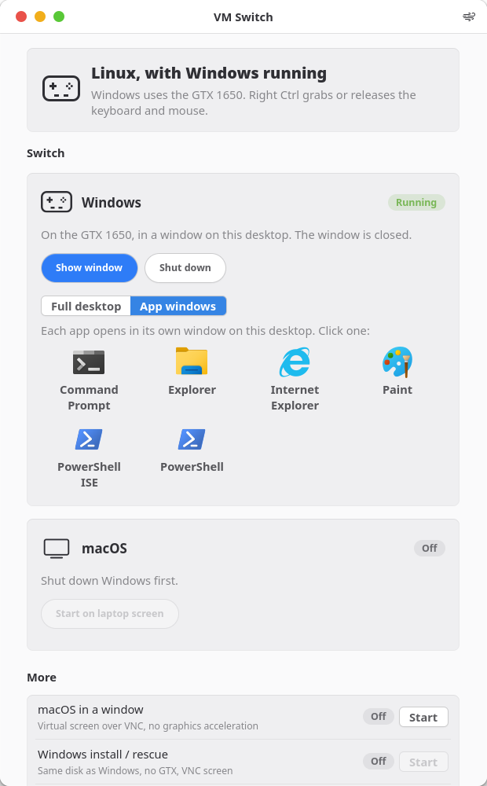

# Windows apps in their own Linux windows (like Parallels Coherence)

[WinApps](https://github.com/winapps-org/winapps) shows single Windows programs as normal windows on the GNOME
desktop, each with its own icon in the app grid. It uses RDP RemoteApp (FreeRDP 3 on Linux), which needs
Windows Pro or Enterprise (here: Windows 10 Enterprise LTSC).

Status: working 2026-11-20. App-grid entries: Windows (full desktop), Explorer, cmd, PowerShell, PowerShell ISE,
Paint, Internet Explorer. Tested: Paint opened as its own window on the GNOME desktop.

## Use


**VM Switch** > Windows card > **App windows**: confirms, signs out the Windows desktop (needed, see below),
closes the Looking Glass window and shows the Windows apps as buttons. Click one: it opens in its own window.
**Full desktop** goes back: closes the app windows (their programs keep running) and opens the Looking Glass
window; log in there.

Without VM Switch:
1. Start Windows: VM Switch > **Start Windows** (WinApps never starts or stops the VM itself).
2. App grid: click a Windows app (e.g. "Explorer", "Word"). It opens in its own window.
   The first start of a session takes a few seconds (RDP login).
3. Terminal: `winapps windows` (whole desktop over RDP), `winapps manual notepad.exe`, `winapps check`.

Linux home is `\\tsclient\home` in Windows; text clipboard works both ways; sound goes to Linux.

## Coherence vs. Looking Glass
| | Looking Glass window (`win-gpu`) | WinApps windows |
|---|---|---|
| Shows | the whole Windows desktop | single apps as Linux windows |
| Picture | uncompressed frames from the GTX | RDP stream (H.264) |
| Good for | games, video, anything fast | office, browser, tools |
| Session | Windows console | RDP session of the same user |

Only one of the two at a time, per Windows user:
- WinApps needs the user **signed out** on the console (Looking Glass): with a desktop open there, the RemoteApp
  login is refused (`LOGON_MSG_BUMP_OPTIONS` in the FreeRDP log). Locking is not enough: Start > user > Sign out.
- Back to Looking Glass: close the WinApps windows, then log in in the Looking Glass window (the RDP session is
  taken over).
- The Deskflow client inside Windows runs in the console session: while you use WinApps, the Mac mouse reaches
  the app windows through the laptop instead (they are normal Linux windows).

## Setup
### Windows (done from Linux with `wexec win10-gpu '<PowerShell>'`, no clicks)
Values from WinApps `oem/RDPApps.reg` plus the GPU policy:
```
HKLM\SYSTEM\CurrentControlSet\Control\Terminal Server                         fDenyTSConnections = 0
HKLM\SYSTEM\CurrentControlSet\Control\Terminal Server\WinStations\RDP-Tcp     UserAuthentication = 1   (NLA)
HKLM\SOFTWARE\Microsoft\Windows NT\CurrentVersion\Terminal Server\TSAppAllowList  fDisabledAllowList = 1
HKLM\SOFTWARE\Policies\Microsoft\Windows NT\Terminal Services                 fAllowUnlistedRemotePrograms = 1
HKLM\SYSTEM\CurrentControlSet\Control\Keyboard Layout                         IgnoreRemoteKeyboardLayout = 1
HKLM\SOFTWARE\Policies\Microsoft\Windows NT\Terminal Services                 bEnumerateHWBeforeSW = 1        (use the GTX in RDP sessions)
                                                                              AVC444ModePreferred = 1
                                                                              AVCHardwareEncodePreferred = 1  (NVENC)
Enable-NetFirewallRule -DisplayGroup 'Remote Desktop'; gpupdate /target:computer /force
```
Skipped from WinApps' `install.bat`: `Container.reg` (switches the clock to UTC; this VM uses local time).

### Linux
```
bash laptop/host/winapps/setup-winapps.sh <windows-user>
```
Installs `dialog` and `openbsd-netcat`, clones WinApps at the tested commit to `~/src/winapps`, writes
`~/.config/winapps/winapps.conf` and the password file `~/.config/winapps/rdp-pass` (mode 600, read through
`RDP_ASKPASS`, so it is not on the FreeRDP command line), then runs WinApps' `setup.sh --user --setupAllOfficiallySupportedApps` (no menus: app scan, `.desktop` entries
in `~/.local/share/applications`, `winapps` in `~/.local/bin`). Add your own installed programs later with
`bash ~/src/winapps/setup.sh --user --add-apps` (interactive).

Problems met during setup (2026-11-20):
| Symptom | Cause | Fix |
|---|---|---|
| `xf_setup_x11: failed to open display`, exit 14 | run over SSH, no `DISPLAY` | script borrows the desktop session's environment |
| setup hangs at `Password:` | FreeRDP 3.33 ignores `RDP_ASKPASS` / `FREERDP_ASKPASS` | `RDP_PASS="$(cat ~/.config/winapps/rdp-pass)"` (password is on the FreeRDP command line, visible to local users only) |
| `LOGON_MSG_BUMP_OPTIONS`, test times out | same user signed in on the console | sign out in Windows first |

Config choices:
- `WAFLAVOR="manual"` + `RDP_IP="192.168.122.13"`: WinApps only connects. With `libvirt` it would run
  `virsh start/suspend` on the VM itself, bypassing `gpu-mode` (the GTX must be moved first) and pausing a VM
  with a passed-through GPU.
- `AUTOPAUSE="off"` for the same reason.

Run it on the laptop's own terminal, or over SSH: the script then borrows `DISPLAY`/`XAUTHORITY` from the
desktop session (`systemctl --user show-environment`). Without that, WinApps' RDP test fails with
`xf_setup_x11: failed to open display` and "REMOTE DESKTOP PROTOCOL FAILURE" (exit 14).
App windows from the app grid open on the laptop screen as usual.

Uninstall: `bash ~/src/winapps/setup.sh --user --uninstall`; `rm -r ~/.config/winapps`.
